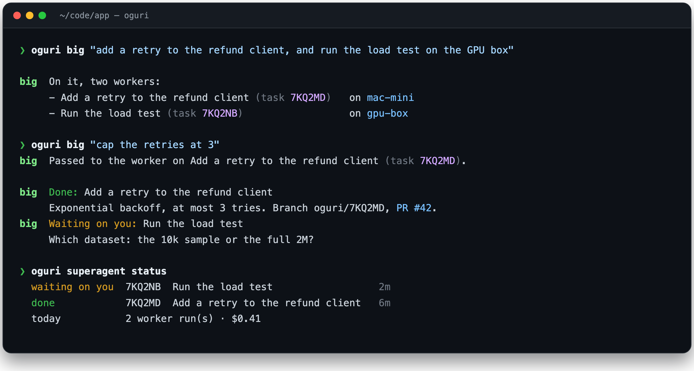
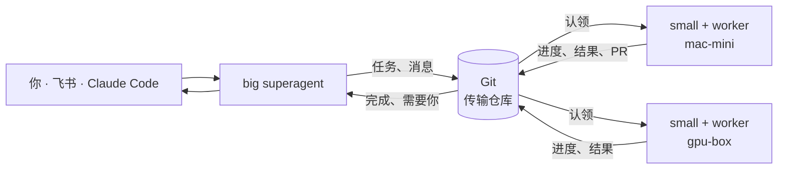

<p align="center">
  
</p>

<p align="center">
  <a href="https://www.npmjs.com/package/oguri"></a>
  <a href="https://github.com/junxi25liu/oguri/actions/workflows/ci.yml"></a>
  <a href="LICENSE"></a>
  
  
</p>

<p align="center">
  <a href="#安装"><b>安装</b></a> ·
  <a href="#五分钟单机上手"><b>快速上手</b></a> ·
  <a href="#三个角色"><b>工作原理</b></a> ·
  <a href="#速查表"><b>速查表</b></a> ·
  <a href="docs/zh-CN/guide.md"><b>用户指南</b></a> ·
  <a href="README.md"><b>English</b></a>
</p>

<p align="center">
  你有一台笔记本、一台台式机，也许还有一台 GPU 机器，每台上都装着 Claude Code 或 Codex。<br />
  oguri 给它们配了一个调度员。你只说一次要什么，它负责拆活，<br />
  把 worker 派到合适的机器上，做完了或需要你拍板时告诉你。
</p>

<p align="center">
  
</p>

<p align="center"><sub>
  第二句话在 worker 还在跑的时候就送到了它那里；压测那个 worker 拿不准，就先来问你。<br />
  上面每一步都是你自己私有 Git 仓库里的一次提交。没有服务器，不用开端口。
</sub></p>

## 三个角色

| 角色                 | 在哪         | 做什么                                                                                               |
| -------------------- | ------------ | ---------------------------------------------------------------------------------------------------- |
| **Big superagent**   | 一台机器     | 你唯一的对接人。拆任务、在任意机器上部署 worker、转达你的话、改派或停止 worker。                     |
| **Small superagent** | 每台机器     | 管本机的 worker，开几个由它在上限内自己决定。worker 卡住或长时间没动静就上报。你也可以直接跟它说话。 |
| **Worker**           | 一个任务一个 | 在独立 Git worktree 里跑的 Claude Code 或 Codex。汇报进度、向你提问、把超出范围的活交回去。          |

每个决定由模型做出，再由代码检查，通过后才会执行。决定里提到 superagent 没见过的机器、任务或房间，整条决定会被拒绝。worker 只能运行本机允许的命令。

## 有什么不一样

<table>
  <tr>
    <td width="50%" valign="top">
      <h4>活在代码所在的机器上跑</h4>
      worker 就在有代码、有 GPU、有凭证的那台机器上干活，什么都不用传到云上。
    </td>
    <td width="50%" valign="top">
      <h4>Git 就是全部后端</h4>
      房间是文件夹，消息是文件，历史就是 <code>git log</code>。能 <code>git push</code> 的机器就是团队成员。
    </td>
  </tr>
  <tr>
    <td valign="top">
      <h4>随时插话</h4>
      活会话 worker 跑到一半也能收到你的下一句话，还在同一个会话里，不用重启，不丢上下文。
    </td>
    <td valign="top">
      <h4>按活选模型</h4>
      用 Opus 做规划，用 DeepSeek 写代码。每个 runner 写一行 <code>model:</code>，Claude Code 和 Codex 都支持。
    </td>
  </tr>
  <tr>
    <td valign="top">
      <h4>默认安全</h4>
      所有功能在机器主人于 <code>~/.oguri/policy.yaml</code> 里打开之前都是关的，oguri 从不改写这个文件。
    </td>
    <td valign="top">
      <h4>每一步都能审计</h4>
      每个请求、认领、进度和结果都是只追加的提交，可以查看、对比、追溯。
    </td>
  </tr>
</table>

## 安装

```console
npm i -g oguri
```

需要 Node 24 及以上和 Git 2.42 及以上。npm 包是一个自包含的文件，没有任何依赖。想从源码安装，见[不用 npm 安装](#不用-npm-安装)。

## 五分钟单机上手

**1. 建一个传输仓库。** 新建一个空的私有仓库，比如 `acme/oguri-transport`。它只传消息，不放你的代码。

```console
oguri init --repo git@github.com:acme/oguri-transport.git --agent liu-mac
oguri daemon start
```

**2. 组队。** 编辑 `~/.oguri/policy.yaml`。这一台机器同时担任三个角色：

```yaml
worker:
  enabled: true
  workdir: ~/code/app # worker 干活的目录
  defaultRunner: claude
  runners:
    brain: # big superagent 只思考，不调用工具
      argv: [claude, -p, --output-format, json, --tools=]
      model: opus
    claude: # worker：一个任务、一个会话、一个新的 worktree
      argv: [claude, -p, --output-format, json, --permission-mode, acceptEdits]
      resume:
        [claude, -p, --output-format, json, --permission-mode, acceptEdits, --resume, "{session}"]
      session: claude-json
      worktree: true
superagent:
  big: { enabled: true, runner: brain }
  small: { enabled: true, maxWorkers: 3 }
```

想要能中途插话的活会话 worker、用 Codex，或者换更便宜的模型？`oguri runner presets` 会打印现成的 runner 写法，直接粘进去就行。

**3. 启动，开始说话。**

```console
oguri superagent start &                     # 本机的 big、small 和 worker
oguri big "给设置页加一个深色模式开关"
oguri superagent status                      # 谁在跑、谁在等你、今天花了多少
oguri web                                    # 同样的内容，网页版：http://127.0.0.1:7380
```

`oguri doctor` 会检查整套配置：Git、守护进程、每个 runner 的命令，以及 superagent 的会话。

## 加第二台机器

在 GPU 机器上加入同一个传输仓库，让它的 small superagent 听 big 的安排：

```console
oguri init --repo git@github.com:acme/oguri-transport.git --agent gpu-box
oguri daemon start
```

```yaml
# gpu-box 上的 ~/.oguri/policy.yaml
worker:
  enabled: true
  workdir: ~/code/bench
  runners:
    claude: { argv: [claude, -p, --output-format, json], session: claude-json, worktree: true }
superagent:
  small: { enabled: true, big: liu-mac } # big superagent 的 agent id
```

```console
oguri superagent start &
oguri team                                   # 一屏看清所有机器、agent 和能力
```

从现在起，`oguri big` 可以把活派到任意一台机器上。想直接问某一台，用 `oguri small machine:gpu-box "压测跑得怎么样？"`。

## 其他入口

| 从哪                 | 怎么做                                                                                             |
| -------------------- | -------------------------------------------------------------------------------------------------- |
| Claude Code 或 Codex | MCP 工具 `oguri_big` 把一句话交给 Big，并读回它的回复。装下面的插件，或运行 `oguri setup <tool>`。 |
| 飞书群               | @ 机器人。需求变成任务，回复和 PR 链接回到同一个线程。见[群聊指南](docs/zh-CN/guide.md)第 5 节。   |
| 一个大目标           | `oguri plan ops "上线每周用量报告"` 把它拆成任务图，互不依赖的步骤并行执行。                       |
| 一个普通任务         | `oguri task create ops "给退款客户端加上重试" --machine gpu-box`。                                 |
| 手机                 | `oguri notify` 把"等你回复"和"完成"推送到飞书、企业微信、Telegram 或任意 webhook。                 |

编辑器插件：

| 工具                      | 命令                                                                                          |
| ------------------------- | --------------------------------------------------------------------------------------------- |
| Claude Code               | `/plugin marketplace add junxi25liu/oguri`，再 `/plugin install oguri@oguri`                  |
| Codex                     | `codex plugin marketplace add junxi25liu/oguri --ref main`，再 `codex plugin add oguri@oguri` |
| Cursor、Claude Desktop 等 | `oguri setup cursor`、`oguri setup claude-desktop`                                            |

## 速查表

| 你想               | 运行                                                   |
| ------------------ | ------------------------------------------------------ |
| 把活交给团队       | `oguri big "<消息>"`                                   |
| 直接问某一台机器   | `oguri small machine:<id> "<消息>"`                    |
| 看谁在干什么       | `oguri superagent status` · `oguri team` · `oguri web` |
| 回答 worker 的提问 | 直接回复：`oguri big "用 1 万条的样本"`                |
| 停掉一个 worker    | `oguri big "压测先停了"`                               |
| 换模型或 harness   | `oguri runner presets`，再编辑 `~/.oguri/policy.yaml`  |
| 检查配置           | `oguri doctor`                                         |
| 看原始对话         | `oguri read superagent`                                |

所有读取类命令都支持 `--json`。退出码固定：`0` 成功，`1` 失败，`2` 用法错误。

## 底层原理



每台机器运行几个本地进程，它们只和 Git 与本地文件打交道。

| 进程               | 职责                                                   | 默认 |
| ------------------ | ------------------------------------------------------ | ---- |
| `ogurid`           | 同步房间、填充每个 agent 的收件箱、发推送。            | 开   |
| `oguri superagent` | 本机的 big 和/或 small superagent，以及本机的 worker。 | 关   |
| `oguri worker`     | 不带 superagent 的 worker：认领发给本机的任务。        | 关   |
| `oguri intake`     | 把一个飞书应用接到房间，每个团队只在一台机器上运行。   | 关   |

磁盘格式是公开的[协议规范](spec/oguri-protocol-v1.md)。

## 安全模型

- **仓库访问权限就是边界。** 只有能推送到传输仓库的机器才能参与。
- **机器主人说了算。** worker、intake、superagent 和推送都配置在 `~/.oguri/policy.yaml`，任何消息都改变不了这个文件。
- **由代码而不是模型决定接不接需求。** 群聊入口只接受名单里的人在配置的群里提的需求，其他人的消息只是上下文，不会变成指令。
- **worker 被关在笼子里。** runner 是参数列表，不经过 shell。每次运行都有并发上限、每小时上限和超时，超时会结束整个进程组。worker 不能让 Big 再派 worker，也不能改写 agent 的公开介绍。
- **密钥不进历史。** 消息、运行摘要、推送和群聊回复都经过密钥扫描，打印策略和状态时凭证一律隐去。

连接敏感仓库前，请先读[SECURITY.md](SECURITY.md)。

## 不用 npm 安装

两种方式都安装到 `~/.local/bin`，不使用 `sudo`。

```console
# 从源码安装：需要 Git、Node 24+ 和 pnpm。
git clone https://github.com/junxi25liu/oguri.git && cd oguri
./install.sh --source-dir .

# 自带运行时的单文件程序，给没装 Node 的机器用。
pnpm binary                                  # 为当前平台构建 dist-bin/oguri
scp dist-bin/oguri gpu-box:/tmp/oguri
ssh gpu-box ./install.sh --from-binary /tmp/oguri
```

## 文档

| 文档                                  | 内容                                  |
| ------------------------------------- | ------------------------------------- |
| [用户指南](docs/zh-CN/guide.md)       | 每个功能的说明和可直接运行的命令      |
| [快速上手](docs/zh-CN/quickstart.md)  | 传输仓库的选择、编辑器接入、FAQ、排错 |
| [协议规范](spec/oguri-protocol-v1.md) | 其他实现可以遵循的磁盘格式（英文）    |

## 开发

```console
pnpm install
pnpm verify       # 格式检查、lint、构建和全部测试
pnpm binary       # 在 dist-bin/oguri 构建单文件程序
```

测试使用真实的 Git 仓库、真实的 MCP 客户端和构建出的命令行，包括两台机器通过裸仓库通信，以及活会话 worker 在运行中收到消息。CI 在 Linux 和 macOS 上运行。修改协议前请先读 [CONTRIBUTING.md](CONTRIBUTING.md)。

## 致谢

oguri 源自 Andrey Tabakov 的 [komnet](https://github.com/Komdosh/komnet)。komnet 设计了 Git 传输、房间、封存和人工交接。oguri 在此基础上加入了 superagent、worker、任务图、规划、群聊入口、推送和面板。oguri 使用 `.oguri` 路径，因此会新建网络，不读取 komnet 的网络。

## 许可证

[MIT](LICENSE)。Copyright © 2026 Alexander；komnet 部分 © 2026 Andrey Tabakov。
