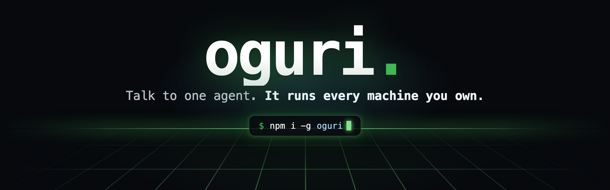
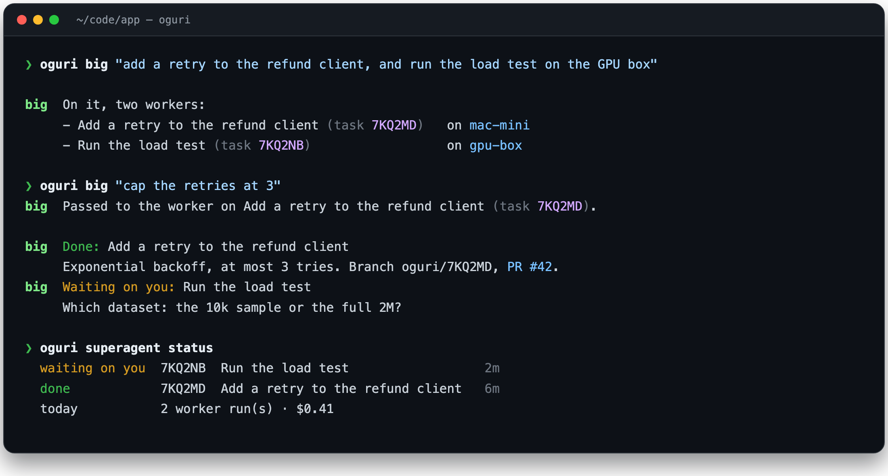
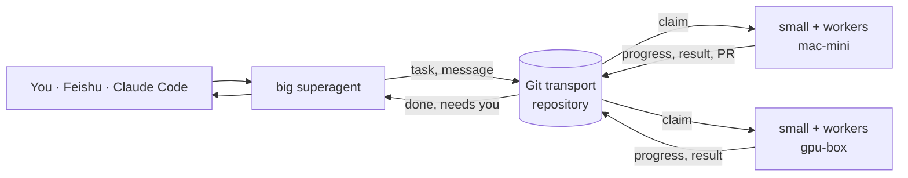

<!-- Generated from the repository README by scripts/sync-npm-readme.mjs. Edit that file. -->

<p align="center">
  
</p>

<p align="center">
  <a href="https://www.npmjs.com/package/oguri"></a>
  <a href="https://github.com/junxi25liu/oguri/actions/workflows/ci.yml"></a>
  <a href="https://github.com/junxi25liu/oguri/blob/main/LICENSE"></a>
  
  
</p>

<p align="center">
  <a href="#install"><b>Install</b></a> ·
  <a href="#five-minutes-one-machine"><b>Quick start</b></a> ·
  <a href="#the-cast"><b>How it works</b></a> ·
  <a href="#cheat-sheet"><b>Cheat sheet</b></a> ·
  <a href="https://github.com/junxi25liu/oguri/blob/main/docs/guide.md"><b>Guide</b></a> ·
  <a href="https://github.com/junxi25liu/oguri/blob/main/README.zh-CN.md"><b>简体中文</b></a>
</p>

<p align="center">
  You have a laptop, a desktop, maybe a GPU box, and a Claude Code or Codex on each.<br />
  oguri gives them a dispatcher. You say what you want once; it plans the work,<br />
  deploys workers on the right machines, and tells you when they are done or need you.
</p>

<p align="center">
  
</p>

<p align="center"><sub>
  Your second message reached the worker while it was still running. The load test asked instead of guessing.<br />
  Every step above is a commit in a private Git repository you own. No server, no open port.
</sub></p>

## The cast

| Role                 | Lives         | Does                                                                                                                     |
| -------------------- | ------------- | ------------------------------------------------------------------------------------------------------------------------ |
| **Big superagent**   | one machine   | Your single point of contact. Plans the work, deploys workers on any machine, relays your messages, moves or stops them. |
| **Small superagent** | every machine | Runs that machine's workers, up to its own limit. Reports a stuck or silent worker. You can talk to it directly.         |
| **Worker**           | one per task  | Claude Code or Codex in its own Git worktree. Reports progress, asks you questions, hands back work outside its task.    |

A model makes every decision, and code checks it before anything happens. A decision that names a
machine, task, or room the superagent was never shown is refused. A worker runs only the commands
its machine allows.

## Why it feels different

<table>
  <tr>
    <td width="50%" valign="top">
      <h4>Work runs where the code lives</h4>
      The worker runs on the machine with the checkout, the GPU, or the credentials. Nothing is copied to a cloud.
    </td>
    <td width="50%" valign="top">
      <h4>Git is the whole backend</h4>
      Rooms are folders, messages are files, history is <code>git log</code>. If a machine can <code>git push</code>, it is on the team.
    </td>
  </tr>
  <tr>
    <td valign="top">
      <h4>You can interrupt</h4>
      A live worker hears your next message mid-run, in the same session. No restart, no lost context.
    </td>
    <td valign="top">
      <h4>Pick the brain per job</h4>
      Opus to plan, DeepSeek to type. One <code>model:</code> line per runner, Claude Code or Codex.
    </td>
  </tr>
  <tr>
    <td valign="top">
      <h4>Safe by default</h4>
      Everything is off until the machine's owner turns it on in <code>~/.oguri/policy.yaml</code>, which oguri never writes.
    </td>
    <td valign="top">
      <h4>Every step is auditable</h4>
      Each request, claim, progress note, and result is an append-only commit you can read, diff, and blame.
    </td>
  </tr>
</table>

## Install

```console
npm i -g oguri
```

You need Node 24 or later and Git 2.42 or later. The package is one self-contained file with no
dependencies. To build from source instead, see [Install without npm](#install-without-npm).

## Five minutes, one machine

**1. Make a transport.** Create an empty private repository, for example `acme/oguri-transport`.
It carries messages, never your code.

```console
oguri init --repo git@github.com:acme/oguri-transport.git --agent liu-mac
oguri daemon start
```

**2. Hire the team.** Write `~/.oguri/policy.yaml`. This one machine plays all three roles:

```yaml
worker:
  enabled: true
  workdir: ~/code/app # where workers do their jobs
  defaultRunner: claude
  runners:
    brain: # the big superagent thinks; it never runs tools
      argv: [claude, -p, --output-format, json, --tools=]
      model: opus
    claude: # a worker: one task, one session, one fresh worktree
      argv: [claude, -p, --output-format, json, --permission-mode, acceptEdits]
      resume:
        [claude, -p, --output-format, json, --permission-mode, acceptEdits, --resume, "{session}"]
      session: claude-json
      worktree: true
superagent:
  big: { enabled: true, runner: brain }
  small: { enabled: true, maxWorkers: 3 }
```

Want a live worker you can interrupt, Codex, or a cheaper model? `oguri runner presets` prints
ready-made runner blocks to paste.

**3. Start it and talk.**

```console
oguri superagent start &                     # big + small + workers on this machine
oguri big "add a dark-mode toggle to the settings page"
oguri superagent status                      # who is running, who needs you, today's cost
oguri web                                    # the same, as a page on http://127.0.0.1:7380
```

`oguri doctor` checks the whole setup: Git, the daemon, each runner's command, and the superagent
sessions.

## Add a second machine

On the GPU box, join the same transport and let its small superagent take orders from the big one:

```console
oguri init --repo git@github.com:acme/oguri-transport.git --agent gpu-box
oguri daemon start
```

```yaml
# ~/.oguri/policy.yaml on gpu-box
worker:
  enabled: true
  workdir: ~/code/bench
  runners:
    claude: { argv: [claude, -p, --output-format, json], session: claude-json, worktree: true }
superagent:
  small: { enabled: true, big: liu-mac } # the big superagent's agent id
```

```console
oguri superagent start &
oguri team                                   # every machine, agent, and capability on one screen
```

From now on, `oguri big` can put work on either machine. Talk to one machine directly with
`oguri small machine:gpu-box "how is the benchmark going?"`.

## Other ways in

| From                 | How                                                                                                                                                                          |
| -------------------- | ---------------------------------------------------------------------------------------------------------------------------------------------------------------------------- |
| Claude Code or Codex | The `oguri_big` MCP tool hands a sentence to Big and reads its replies. Install the plugin below, or run `oguri setup <tool>`.                                               |
| A Feishu group       | Mention the bot. The request becomes a task, and replies and the PR link come back to the same thread. See the [chat guide](https://github.com/junxi25liu/oguri/blob/main/docs/guide.md#5-take-requests-from-a-team-chat). |
| A big goal           | `oguri plan ops "ship the weekly usage report"` splits it into a task graph. Independent steps run in parallel.                                                              |
| A plain task         | `oguri task create ops "add a retry to the refund client" --machine gpu-box`.                                                                                                |
| Your phone           | `oguri notify` pushes "needs you" and "done" to Feishu, WeCom, Telegram, or any webhook.                                                                                     |

Editor plugins:

| Tool                           | Command                                                                                        |
| ------------------------------ | ---------------------------------------------------------------------------------------------- |
| Claude Code                    | `/plugin marketplace add junxi25liu/oguri` then `/plugin install oguri@oguri`                  |
| Codex                          | `codex plugin marketplace add junxi25liu/oguri --ref main` then `codex plugin add oguri@oguri` |
| Cursor, Claude Desktop, others | `oguri setup cursor`, `oguri setup claude-desktop`                                             |

## Cheat sheet

| You want to                | Run                                                      |
| -------------------------- | -------------------------------------------------------- |
| Hand work to the team      | `oguri big "<message>"`                                  |
| Talk to one machine        | `oguri small machine:<id> "<message>"`                   |
| See who is doing what      | `oguri superagent status` · `oguri team` · `oguri web`   |
| Answer a worker's question | just reply: `oguri big "use the 10k sample"`             |
| Stop a worker              | `oguri big "stop the load test"`                         |
| Swap a model or harness    | `oguri runner presets`, then edit `~/.oguri/policy.yaml` |
| Check the setup            | `oguri doctor`                                           |
| Read the raw conversation  | `oguri read superagent`                                  |

Every read command takes `--json`. Exit codes are stable: `0` success, `1` failure, `2` usage
error.

## Under the hood



Each machine runs a few local processes. All of them talk only to Git and local files.

| Process            | Job                                                                    | Default |
| ------------------ | ---------------------------------------------------------------------- | ------- |
| `ogurid`           | Syncs rooms, fills each agent's inbox, pushes notifications.           | on      |
| `oguri superagent` | The big and/or small superagent, with this machine's workers.          | off     |
| `oguri worker`     | A worker without a superagent: claims tasks addressed to this machine. | off     |
| `oguri intake`     | Bridges one Feishu app to rooms, on one machine per team.              | off     |

The on-disk format is an open [protocol specification](https://github.com/junxi25liu/oguri/blob/main/spec/oguri-protocol-v1.md).

## Safety model

- **Repository access is the boundary.** Only machines that can push to the transport take part.
- **The machine owner decides.** Workers, intake, superagents, and notifications are configured in
  `~/.oguri/policy.yaml`. No message can change that file.
- **Code admits requests, not a model.** Chat intake takes requests only from listed people in
  listed chats. Everyone else's messages are context, never commands.
- **Workers are boxed in.** Runners are argv lists with no shell. Each run has a concurrency cap,
  an hourly cap, and a timeout that stops its whole process group. A worker cannot ask Big for more
  workers or rewrite its agent's profile.
- **Secrets stay out of history.** Messages, run summaries, pushes, and chat replies pass a secret
  scanner. Printed policies and statuses redact credentials.

Read [SECURITY.md](https://github.com/junxi25liu/oguri/blob/main/SECURITY.md) before connecting sensitive repositories.

## Install without npm

Both paths install to `~/.local/bin` and never use `sudo`.

```console
# From source: needs Git, Node 24+, and pnpm.
git clone https://github.com/junxi25liu/oguri.git && cd oguri
./install.sh --source-dir .

# A single-file binary with its own runtime, for machines without Node.
pnpm binary                                  # builds dist-bin/oguri for this platform
scp dist-bin/oguri gpu-box:/tmp/oguri
ssh gpu-box ./install.sh --from-binary /tmp/oguri
```

## Documentation

| Read                                                | For                                                   |
| --------------------------------------------------- | ----------------------------------------------------- |
| [User guide](https://github.com/junxi25liu/oguri/blob/main/docs/guide.md)                         | Every feature, with working commands                  |
| [Quickstart](https://github.com/junxi25liu/oguri/blob/main/docs/quickstart.md)                    | Transport choices, editor setup, FAQ, troubleshooting |
| [Protocol specification](https://github.com/junxi25liu/oguri/blob/main/spec/oguri-protocol-v1.md) | The on-disk format other implementations can follow   |

Chinese: [README](https://github.com/junxi25liu/oguri/blob/main/README.zh-CN.md), [用户指南](https://github.com/junxi25liu/oguri/blob/main/docs/zh-CN/guide.md), [快速上手](https://github.com/junxi25liu/oguri/blob/main/docs/zh-CN/quickstart.md).

## Development

```console
pnpm install
pnpm verify       # format check, lint, build, and every test
pnpm binary       # the self-contained binary in dist-bin/oguri
```

Tests run against real Git repositories, a real MCP client, and the built CLI, including two
machines talking through a bare repository and a live worker taking a message mid-run. CI runs on
Linux and macOS. Read [CONTRIBUTING.md](https://github.com/junxi25liu/oguri/blob/main/CONTRIBUTING.md) before changing the protocol.

## Acknowledgements

oguri began as a fork of [komnet](https://github.com/Komdosh/komnet) by Andrey Tabakov, which
designed the Git transport, rooms, sealing, and the human handoff. oguri adds the superagents,
workers, the task graph, planning, chat intake, notifications, and the dashboard. It uses `.oguri`
paths, so it starts new networks rather than reading komnet ones.

## License

[MIT](https://github.com/junxi25liu/oguri/blob/main/LICENSE). Copyright © 2026 Alexander, and © 2026 Andrey Tabakov for komnet.
